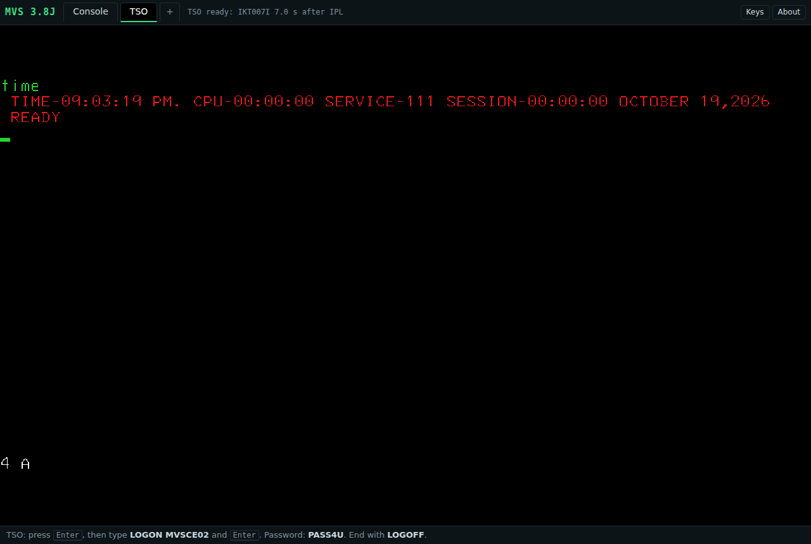

# MVS 3.8J in the browser

IBM MVS 3.8J (MVS/CE) runs on the SDL Hercules Hyperion mainframe emulator, compiled to WebAssembly.
Everything runs in your browser tab: no server-side emulator, no websocket proxy. The web server only
serves static files.

Runs MVS/CE by Philip Young (https://github.com/MVS-sysgen/sysgen), based on Jay Moseley's MVS 3.8j sysgen
(http://www.jaymoseley.com/hercules/), with KICKS for TSO by Mike Noel (http://www.kicksfortso.com/), a CICS-like
transaction monitor that runs under TSO, and the CardDemo sample application
(https://github.com/aws-samples/aws-mainframe-modernization-carddemo). Emulation by Hercules Hyperion.

You see the IPL on the MVS master console (Console tab), then you log on to TSO in a 3270 terminal
(TSO tab). TSO user `MVSCE02`, password `PASS4U` (the public MVS/CE defaults).

**Live demo:** https://webmvs.com



## What it does
- About 4 MB of disk data loads before the IPL; the rest of the disks (62 MB in 620 small chunk files, KICKS and CardDemo included) loads only when MVS reads it. A second visit uses the
  browser cache. Measured (headless Playwright on the build host, cold visit, the test logs
  on after the 1.5 s tab switch): TSO READY 9.4-9.9 s after the page opens in Chromium (WebKit 8.7-9.4 s); with a
  9 Mbit/s link and 60 ms latency 13.4-13.7 s.
- Firefox: the slow Firefox times in the test reports (TSO READY 16-17 s, IKT007I 10-12 s) are from **Playwright's
  own patched Firefox build** (142.0.1, `firefox-1495`), which runs WebAssembly about 5 times slower than the
  official Mozilla build of the same version (measured with a plain integer loop, with and without Playwright
  attached). Official Firefox 142.0.1 and 158.0.1 (`scripts/realff.sh`, same host): IKT007I 4.5-4.9 s after the page
  opens (Chromium 3.8-4.0 s), and the CPU-bound benchmark job ran faster than in Chromium (GO step 14.2-15.5 s against 21.7 s).
  Not known: why the Playwright build is slow; the full time to TSO READY in an official Firefox (Playwright can not
  drive it); Firefox on other machines.
- Console tab: the real MVS master console (3270 at device 0010). You can type operator commands
  (for example `D A,L`).
- TSO tab: TSO on 3270 terminals 0400-0403. `+` opens one more TSO session.
- Your disks are saved in your browser (OPFS). A data set member that you save is still there after a reload.
  Use **Shut down** before you close the tab; **Reset machine** goes back to the original disks.
- On a phone the terminal gets most of the screen: **?** shows how to log on, **i** the credits, and **⋯**
  History, Shut down, Reset machine and About. **Keys** shows or hides the 3270 keys (the choice is remembered).
- `?debug=1` shows the Hercules log and command line. `?persist=0` starts a fresh machine at every load.

Supported: current desktop Chrome/Edge, Firefox, Safari (tested with Playwright Chromium, Firefox and
WebKit). The wasm memory is 112 MiB; the browser processes use up to about 1 GB in Firefox and WebKit.

## KICKS for TSO
[KICKS for TSO](http://www.kicksfortso.com/) 1.5.0 by Mike Noel is installed on its own volume, KICKS0
(device 0351). It is a CICS-like transaction monitor: CICS-style COBOL and C programs run in your TSO session.
Its disk data loads only when you use it.

1. On the TSO tab, log on as `MVSCE02` (password `PASS4U`).
2. At `READY`, type `KICKS` and press Enter. KICKS lists the modules it loads; press Enter at `***`.
3. The KICKS sign-on screen (`KSGM`) shows. Press Clear to get a blank screen, where you type a transaction
   ID and press Enter.
4. Try `INQ1`, the customer inquiry from the Murach CICS samples: type `400001` as the customer number and press
   Enter (customer MCDONALD). PF3 goes to the Murach master menu (`MENU`); PF3 again leaves it.
5. `BTC0` shows the menu of the TAC sample application; PF12 returns to KICKS.
6. To leave KICKS: press Clear, type `KSSF` and press Enter. The screen goes blank: press Enter once more for
   `READY`.

Your own KICKS data sets (`MVSCE02.KICKS.*`) are created at the first start. ANS COBOL (`COBUCLG` and the
other COBOL procedures) and GCC (in the `GCC` and `PDPCLIB` libraries) are available for your own programs; the
KICKS User's Guide in the distribution zip shows how to translate, compile and run them.

KICKS is not in this repository: its license allows redistribution of the complete original package only.
`scripts/build.sh kicks` downloads the distribution zip (sha256 pinned) and installs it with a native Hercules
(`scripts/kicks-install.py`, following the KICKS installation guide). The site offers the unmodified zip at
`/kicks/kicks-tso-v1r5m0.zip` with its license, `/kicks/kicks-license.txt`.

## CardDemo
[CardDemo](https://github.com/aws-samples/aws-mainframe-modernization-carddemo) is a credit card sample
application (CICS, COBOL, VSAM). Part of it runs here under KICKS, on its own volume CARDD0 (device 0352),
converted to the ANS COBOL of MVS 3.8J. Its disk data loads only when you use it.

1. On the TSO tab, log on as `MVSCE02` (password `PASS4U`).
2. At `READY`, type `CARDDEMO` and press Enter. KICKS lists the modules it loads; press Enter at `***`.
3. The CardDemo sign-on screen shows. Sign on as `USER0001` (a regular user) or `ADMIN001` (an administrator),
   password `PASSWORD`. The other users are `USER0002`-`USER0005` and `ADMIN002`-`ADMIN005`, same password.
4. The main menu (users) or the admin menu (administrators) shows. Type an option number and press Enter.
   PF3 goes back; PF3 at the sign-on screen ends CardDemo and KICKS (press Enter for `READY`).

What works (the original programs, converted):

| Menu | Option | Program | |
|---|---|---|---|
| sign-on | | COSGN00C | users from the USRSEC file |
| main menu | | COMEN01C | |
| main menu | 1 Account View | COACTVWC | account, customer and card data (try account `00000000001`) |
| main menu | 2 Account Update | COACTUPC | account number, Enter, change the fields, Enter checks them, PF5 saves |
| main menu | 3 Credit Card List | COCRDLIC | PF7/PF8 page |
| main menu | 4 Credit Card View | COCRDSLC | account and card number (e.g. `00000000001`, `9680294154603697`) |
| main menu | 5 Credit Card Update | COCRDUPC | account and card number, change name, status or expiry, Enter, PF5 saves |
| main menu | 6 Transaction List | COTRN00C | PF7/PF8 page |
| main menu | 7 Transaction View | COTRN01C | transaction id (e.g. `0000000000683580`) |
| main menu | 8 Transaction Add | COTRN02C | account or card number, the transaction fields, `Y` to confirm |
| main menu | 9 Transaction Reports | CORPT00C | `X` on Monthly, Yearly or Custom (start and end date), `Y` submits the report job |
| main menu | 10 Bill Payment | COBIL00C | account number, `Y` pays the whole balance (it adds a payment transaction) |
| admin menu | | COADM01C | |
| admin menu | 1 User List | COUSR00C | PF7/PF8 page, `U` or `D` on a line updates or deletes that user |
| admin menu | 2 User Add | COUSR01C | |
| admin menu | 3 User Update | COUSR02C | user id, Enter, change the fields, PF5 saves |
| admin menu | 4 User Delete | COUSR03C | user id, Enter, PF5 deletes |
| admin menu | 5 Transaction Type List/Update | COTRTLIC | filter by type or description; `U` on a line (change the description) or `D`, PF10 saves |
| admin menu | 6 Transaction Type Maintenance | COTRTUPC | type code, Enter; PF5 adds a new type or saves a change, PF4 deletes |

In the card and transaction lists, `S` on a line shows that card or transaction (`U` in the card list updates it).

The update screens keep the original checks. Some sample records do not pass them as shipped (for account
`00000000001`: FICO score 274 is below 300, phone 2 area code 373 is not a US general-purpose code, and zip
12546 does not match state NC), so fix those fields too before PF5 saves. KICKS changes what you type to
capital letters, so names and addresses saved from these screens are stored in capitals.

Transaction reports: option 9 submits the job TRNRPT00, which writes the report to `CARDDEMO.TRANREPT`. After
CardDemo ends, type `REVIEW 'CARDDEMO.TRANREPT'` at `READY` to read it (PF8 pages, PF3 ends). The sample
transactions are dated 2022, so use Custom with dates in 2022; a month or year without transactions gives a report
with totals only. Changes from the original: CICS sends the job to the internal reader through the transient data
queue JOBS, KICKS through its spool commands (SPOOLOPEN to `INTRDR`); the job has no procedure library or DFSORT,
so a small program (`CDTRFLT`) keeps the transactions processed between the dates and IDCAMS puts them in card
number order (through a work file with an alternate index; the OS/360 sort on this system needs 2314 work disks,
which webmvs does not have) before the original report program CBTRN03C runs. The transaction file has no
processing date for the sample records, so the install uses their origination date. KICKS submits the job without a
user, so it runs under RAKF's default batch account; RAKF gives every user ALTER access to `CARDDEMO.*` for the
job's work files and the report.

Transaction types: the two admin options use Db2 in the original. Here the types are in the VSAM file
`CARDDEMO.TRANTYPE.KSDS` (the one the batch programs read), and each SQL statement is replaced by KICKS file
commands (`scripts/carddemo/sqlvsam.py`). As with Db2, a type that has categories (in
`CARDDEMO.TRANCATG.KSDS`) cannot be deleted; a type you add can. The description filter ignores capitals.

Batch: the file readers CBACT02C, CBACT03C and CBCUS01C are in `CARDDEMO.LOADLIB`; the job
`CARDDEMO.JCL(READALL)` runs them (`SUBMIT 'CARDDEMO.JCL(READALL)'` at `READY`).

Not in this version: pending authorizations (IMS, MQ) and the other batch jobs (they need SORT,
Db2 or language features this COBOL does not have). Their menu options answer
"... is not available in this version". The data files are read and written by the programs that work; your
changes stay in your browser like the rest of the system. When a new version of webmvs changes the CardDemo
volume, it starts again from its original data (the update notice says so; your own data sets are kept).

CardDemo is not in this repository. `scripts/build.sh carddemo` downloads the repository at a pinned commit
(sha256 pinned) and installs it with a native Hercules (`scripts/carddemo-install.py`): the COBOL programs are
converted by `scripts/carddemo/cob2ans.py` (with the source changes in `scripts/carddemo/fixes.py` and small
COBOL helper subprograms in `scripts/carddemo/helpers/`), the BMS maps go through the KICKS map generator, the
data files become VSAM KSDS files with their alternate indexes (catalog `UCCARDD0`, alias `CARDDEMO`). The
original and the converted sources are on the volume (`CARDDEMO.ORIGCBL`, `CARDDEMO.COBOL`).

## File transfer (Download, Upload)
The **Download** and **Upload** buttons (on a phone: in the `...` menu) move data sets between MVS and your
computer with IND$FILE, the 3270 file transfer program, which is installed in `SYS2.CMDLIB`.

1. Log on to TSO and stay at `READY` (leave ISPF with `=X`, KICKS with `KSSF`).
2. Download: type the data set name (`SYS1.PARMLIB(IEASYS00)`, `CARDDEMO.COPYLIB(COSGN00)`), pick Text or
   Binary, press Download. The page types the `IND$FILE GET` command on the TSO tab and saves the result as a
   browser download.
3. Upload: type the name of the new data set (or of a member in a library that exists), choose the file, press
   Upload. A new data set is created (Text: FB 80, Binary: U; other attributes under "New data set
   attributes"); an existing one is replaced.

Names are always fully qualified (`MVSCE02.MY.DATA`). Text means EBCDIC on MVS and ASCII with CR LF on your
computer (trailing blanks of fixed-length records are dropped on the way out); Binary keeps the bytes as they are.
The transfer uses DFT (structured fields) in 4 KB frames: larger upload frames end the TSO session on this
system. About 1 MB takes a few seconds; uploads are limited to 4 MB.

Why IND$FILE: the site has no server, so an HTTP endpoint that maps to data sets would have to read and write
the CCKD disks in the page, with MVS running on them and caching them (VTOC, catalog, PDS directories); IND$FILE
does the I/O inside MVS, under your TSO user and its RAKF rules, and needs only the terminal connection the page
already has. Hercules card reader and punch devices would also work, but only through batch jobs (JCL around
every transfer, and the output sorted out from the JES2 punch), and they carry 80-byte cards.

`scripts/build.sh indfile` installs IND$FILE 2.0.5 (Mike Rayborn) from the package MVS/CE ships for its
package manager (`MVP/packages/IND$FILE`), as `RX MVP INSTALL IND$FILE` would (`scripts/indfile-install.py`).

## How it works
```
 Browser tab (cross-origin isolated: COOP/COEP headers, or coi-serviceworker on GitHub Pages)
 +-----------------------------------------------------------------------------------------+
 | Main thread (page)                                                                      |
 |   web/app: loader, tabs, keyboard          athornton/tn3270 (3270 data stream, canvas)  |
 |   web/runtime/mvs-runtime.js  --- raw TN3270 bytes --->  one terminal per tab           |
 |        |  SharedArrayBuffer byte rings + futex doorbell (no sockets, no network)        |
 +--------|--------------------------------------------------------------------------------+
 | Web workers (Emscripten pthreads, one wasm32 memory)                                    |
 |   hercules.wasm = SDL Hyperion 4.9.1 + patches/hyperion/*.patch + src/wasm/*            |
 |     wasm_main.c    starts Hercules without a panel (herclin model), hidden commands     |
 |     wasmsock.c     vsock_* calls: console.c's TN3270 server talks to the page's rings   |
 |     CPU thread (S/370, NUMCPU 1)  device threads  CCKD DASD                             |
 |     lazydasd.cpp   WasmFS backend: track chunk -> fetch() in the worker -> Cache API    |
 |     shadow files   CCKD sf= files on OPFS (your changes; base volumes stay read-only)   |
 +-----------------------------------------------------------------------------------------+
        | HTTP GET of whole files (no Range needed)
 Static host (GitHub Pages / Cloudflare Pages / any web server)
   index.html app.js runtime/hercules.{js,wasm} conf/ boot/ dasd/manifest.json dasd/c/<sha256>
```
- The DASD volumes are the MVS/CE v3.0.0 release volumes, compressed CCKD, split into content-addressed
  chunk files. A boot list (recorded track traces of real IPLs, `dasd/manifest/`) selects the chunks that are fetched before the IPL.
- The page answers the NIP prompt on the console like an operator, sets roll mode, and switches to the
  TSO tab when `IKT007I` (TSO ready) shows.
- Design, decisions and measured results: [docs/RESEARCH.md](docs/RESEARCH.md) and [docs/DEPLOY.md](docs/DEPLOY.md).

## Repository layout
```
patches/hyperion/   changes to SDL Hyperion, as separate patch files (QPL 1.0 section 3)
src/wasm/           new C/C++/JS files linked into hercules.wasm
conf/               Hercules configuration and rc files (web and native)
web/app/            the visitor page (TypeScript, esbuild)
web/runtime/        the runtime module that loads and drives hercules.wasm
web/vendor/         vendored athornton/tn3270 and coi-serviceworker (pinned, not modified)
scripts/            host setup, build, DASD chunking, bundle, tests
dasd/manifest/      boot track lists (the DASD images themselves are not in git)
bench/              micro benchmarks (longjmp, wasm exceptions)
docs/               research, deploy guide, pinned versions
LICENSES/           Hercules QPL 1.0 and copyright notice
LICENSE NOTICE      Apache-2.0 license of the project code, third-party notices
```

## Build
The build runs on an x86_64 Ubuntu 24.04 host (a VM or any other machine; 4 or more cores,
8 GB RAM and 20 GB disk are enough). The scripts expect the repository at `~/webmvs`.
All versions are pinned in [docs/PINS.md](docs/PINS.md).

1. Host packages and emsdk 6.0.13 (pinned; do not use `latest`):
   ```
   git clone https://github.com/paulovitorjp/webmvs ~/webmvs && cd ~/webmvs
   scripts/host-setup.sh
   git clone https://github.com/emscripten-core/emsdk ~/emsdk
   (cd ~/emsdk && ./emsdk install 6.0.13 && ./emsdk activate 6.0.13)
   ```
2. Hyperion source (pinned commit `ee86c4d`, tag `Release_4.9.1`) and a native reference build
   (this also clones `~/src/hyperion`, which the wasm build copies):
   ```
   scripts/build-native.sh
   ```
3. MVS/CE v3.0.0 release (downloaded from GitHub, sha256 checked):
   ```
   scripts/get-mvsce.sh
   ```
4. The browser build (outputs in `~/build/webmvs`; set `B=` for another dir):
   ```
   scripts/build.sh ext       # Hyperion extpkgs (crypto, decNumber, SoftFloat, telnet) for wasm32
   scripts/build.sh build     # patches + emconfigure + make -> hercules.js / hercules.wasm
   scripts/build.sh kicks     # KICKS for TSO: download (sha256 pinned) + install with native Hercules (about 5 min)
   scripts/build.sh carddemo  # CardDemo: download (sha256 pinned), convert, install on CARDD0 (about 3 min)
   scripts/build.sh indfile   # IND$FILE (3270 file transfer) from the MVS/CE package into SYS2.CMDLIB (about 1 min)
   scripts/build.sh chunks    # lazy DASD chunks + manifest from the MVS/CE volumes (boot traces: dasd/manifest/)
   scripts/build.sh seed      # seed shadow file (SMF off)
   ```
5. The deployable site (`dist/` in the repo, with content-hashed file names, `_headers`, `.nojekyll` and
   `404.html`; `--tar` also writes `dist-<build>.tar.gz` + `.sha256` for a GitHub Release; see `docs/DEPLOY.md`):
   ```
   scripts/bundle.sh --tar
   ```
6. Serve it locally (127.0.0.1 only) like the two hosts: `node scripts/pages-emu.mjs --root dist --port 8402 --profile cloudflare`
   (headers from `_headers`) or `--profile github` (no headers: coi-serviceworker), then open `http://localhost:<port>/`.

7. Deploy to Cloudflare Pages (the live site; details in [docs/DEPLOY.md](docs/DEPLOY.md), section 4):
   ```
   npx wrangler@4 login                                              # or set CLOUDFLARE_API_TOKEN
   npx wrangler@4 pages project create webmvs --production-branch main   # once
   npx wrangler@4 pages deploy dist --project-name webmvs --branch main
   ```

The bundle is a plain static site. Host it on any server that sets
`Cross-Origin-Opener-Policy: same-origin` and `Cross-Origin-Embedder-Policy: require-corp`
(the bundle has a `_headers` file for Cloudflare Pages / Netlify). On a host without custom headers
(GitHub Pages) `coi-serviceworker.js` makes the page cross-origin isolated; the first visit reloads once.

## License
The code of this project (the runtime C/C++ in `src/wasm/`, the page and runtime JS/TS in `web/app/` and
`web/runtime/`, `scripts/`, `conf/` except `conf/mvsce-stock/`, and `docs/`) is licensed under the
[Apache License, Version 2.0](LICENSE). Copyright 2026 Paulo Pereira and the webmvs authors. The source files have the
line `SPDX-License-Identifier: Apache-2.0`. See [NOTICE](NOTICE) for the third-party notices.

These parts are NOT under the Apache License and keep their own licenses:
- the Hercules patches in `patches/hyperion/`: Q Public License 1.0 (the Hercules license,
  [LICENSES/hercules-QPL-1.0.html](LICENSES/hercules-QPL-1.0.html));
- vendored code: `web/vendor/tn3270/` (MIT), `web/vendor/coi-serviceworker/` (MIT), the 3270 font (BSD-style);
- MVS 3.8J is public domain; the MVS/CE add-ons keep their own terms;
- KICKS for TSO (Mike Noel): its own license (`kicks-license.txt` in the distribution zip, also on the site at
  `/kicks/kicks-license.txt`). No KICKS file is in this repository.
- CardDemo (Copyright Amazon.com, Inc. or its affiliates): Apache-2.0. No CardDemo file is in this repository;
  the site has its `LICENSE` and `NOTICE` in `/carddemo/`.

Each bundle has `LICENSE`, `NOTICE` and the QPL text in its `source/` folder (and `licenses/`, `SOURCE.txt`).

## Credits and licenses
| Component | License | Notes |
|---|---|---|
| [SDL Hercules 4.x Hyperion](https://github.com/SDL-Hercules-390/hyperion) (Roger Bowler, Jan Jaeger, Jay Maynard and others) | [Q Public License 1.0](LICENSES/hercules-QPL-1.0.html) | see below |
| Hercules extpkgs crypto, decNumber, SoftFloat, telnet | their own licenses (copied into the bundle `licenses/`) | built unmodified at pinned commits |
| MVS 3.8J (IBM) | public domain | |
| [MVS/CE](https://github.com/MVS-sysgen/sysgen) v3.0.0 (MVS-sysgen project) | see its repository | the DASD volumes are built from its release; the sysgen automates Jay Moseley's procedures |
| [Jay Moseley's MVS 3.8J sysgen](https://www.jaymoseley.com/hercules/) | | the basis of MVS/CE |
| [KICKS for TSO](http://www.kicksfortso.com/) 1.5.0 (Mike Noel) | KICKS license (`kicks-license.txt`; free use, redistribution of the complete package only) | installed on the KICKS0 volume by `scripts/build.sh kicks`; the site offers the unmodified zip in `/kicks/` |
| [CardDemo](https://github.com/aws-samples/aws-mainframe-modernization-carddemo) (Copyright Amazon.com, Inc. or its affiliates) | Apache-2.0 | modified (converted to ANS COBOL for KICKS, the Db2 programs on VSAM, the report job without DFSORT) and installed on the CARDD0 volume by `scripts/build.sh carddemo` |
| IND$FILE 2.0.5 (Mike Rayborn) | free, use at your own risk (its README); distributed with MVS/CE's package manager | installed in `SYS2.CMDLIB` from the MVS/CE release by `scripts/build.sh indfile` |
| [athornton/tn3270](https://github.com/athornton/tn3270) (Adam Thornton) | MIT | `web/vendor/tn3270/LICENSE` |
| 3270 font (x3270 BDF font, Paul Mattes, Jeff Sparkes, GTRC) | BSD-style | `web/vendor/tn3270/packages/canvas/assets/LICENSE-3270-font.txt`; see also [rbanffy/3270font](https://github.com/rbanffy/3270font) |
| [coi-serviceworker](https://github.com/gzuidhof/coi-serviceworker) (Guido Zuidhof) | MIT | `web/vendor/coi-serviceworker/LICENSE` |
| Emscripten | MIT / University of Illinois NCSA | toolchain and runtime JS |
| The code of this project (`src/wasm`, `web/app`, `web/runtime`, `scripts`, `conf` except `conf/mvsce-stock/`, `docs`) | [Apache-2.0](LICENSE) | the explicit license that QPL section 6 requires for items that link with Hercules |
| `conf/mvsce-stock/` (copies of the MVS/CE v3.0.0 stock configuration, for reference) | MVS/CE terms (the upstream repository has no license file) | not covered by this project's Apache-2.0 license |

**Hercules QPL 1.0 obligations.** `hercules.wasm` is a modified, machine-executable form of Hercules. So:
- The changes are distributed separately from the original, as patch files in `patches/hyperion/`
  (section 3). They do not change any copyright notice (3a).
- Every deployed bundle includes the license text (`licenses/hercules-QPL-1.0.html`), the copyright notice,
  and a prominent notice (`SOURCE.txt`, the About dialog) that says where the complete source is: the
  pinned Hyperion commit, the patches, the new linked files (`src/wasm/`) and the build scripts, at no
  charge (section 4). The bundle also contains a copy of that source in `source/`.
- The new files linked into the binary (`src/wasm/`) are published in source form with an explicit license
  that allows use and redistribution (section 6).

This project is not affiliated with IBM, the Hercules project, or the MVS/CE project.
